# Lab 4 – Working with Excel (PowerShell ImportExcel Module)

**Name:** Kashif Sharma\
**Student ID:** 991857768\
**Course:** SYST – PowerShell Scripting, Sheridan College\
**Date:** 11th October 2026

---

## Introduction

In this lab, I learned how to use the **ImportExcel** PowerShell module to work with Excel files without having Microsoft Excel installed. All the work was done from the VS Code terminal on my host machine. I copied the files to my Hyper-V Windows Server (`192.168.1.20`) and ran the commands there through `Enter-PSSession`. This README shows my commands, screenshots of the output, a short description of each step, and a reflection at the end.

## Files in this repository

| File | Description |
|---|---|
| `Fruits.xlsx` | Input file from Slate (Fruits / Quantity table) |
| `KashifLab4Report.xlsx` | Final file with the formatted **StaffLocations** table and the **FruitOverviewChart** chart |
| `Lab-4_KashifSharma_991857768_Working_With_Excel.docx` | My Word document for this lab |
| `screenshots/` | All screenshots used in this README |

---

## Step 1: Install the ImportExcel module

```powershell
Install-Module -Name ImportExcel
```

This command downloads and installs the ImportExcel module from the PowerShell Gallery. The module gives me commands like `Import-Excel` and `Export-Excel`, which I use to read and write Excel files. What I like about this module is that it does not need Microsoft Excel. It reads and writes `.xlsx` files by itself, so it works on a server that has no Office installed.

When I ran the same command on the server, it failed with a NuGet error because the server has no internet access. To fix this, I downloaded the module on my host machine with `Save-Module` and copied it to the server's module folder with `Copy-Item -ToSession`.

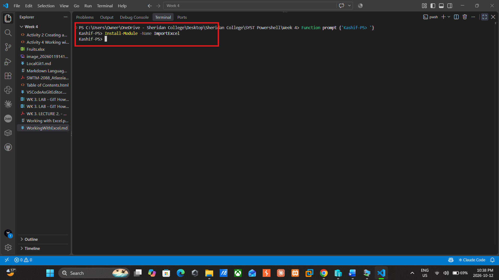

## Step 2: Copy Fruits.xlsx from the host machine to the server

```powershell
$session = New-PSSession 192.168.1.20 -Credential Kashif.powershell.com\administrator
$copyParaams = @{
    Path        = "C:\Users\Owner\OneDrive - Sheridan College\Desktop\Sheridan College\SYST Powershell\Week 4\Fruits.xlsx"
    Destination = "C:\Users\Administrator\Documents\Lab4_WorkingWithExcel"
    ToSession   = $session
}
Copy-Item @copyParaams
$session
Invoke-Command -Session $session -ScriptBlock { Test-Path "C:\Users\Administrator\Documents\Lab4_WorkingWithExcel\Fruits.xlsx" }
```

First, I opened a remote session to the server with `New-PSSession` and saved it in `$session`. Then I put the copy settings in a hashtable: `Path` is where Fruits.xlsx is on my laptop, `Destination` is the folder on the server, and `ToSession` tells PowerShell which session to send it through. `Copy-Item @copyParaams` uses splatting, so each key in the hashtable becomes a parameter. Typing `$session` showed **State: Opened**, which means the connection works. `Test-Path`, run on the server with `Invoke-Command`, returned **True**, so the file was copied successfully.

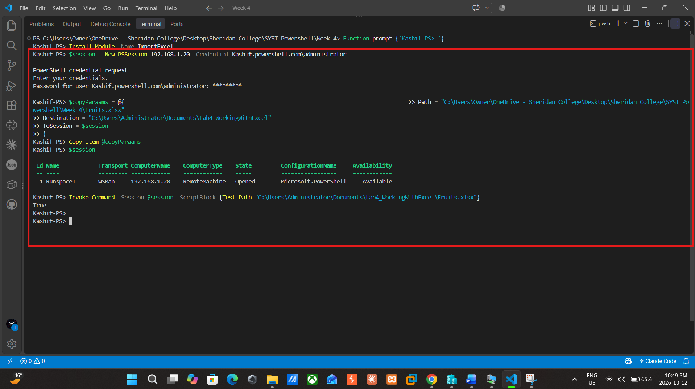

## Step 3: Log in to the server with Enter-PSSession

```powershell
Enter-PSSession -ComputerName 192.168.1.20 -Credential Kashif.powershell.com\Administrator
function prompt {'Kashif-PS>'}
```

After entering my password, the prompt changed to `[192.168.1.20]:`, which shows that every command after this runs on the server, not on my laptop. I also changed the prompt to `Kashif-PS>` so it is shorter and easier to read in the screenshots.

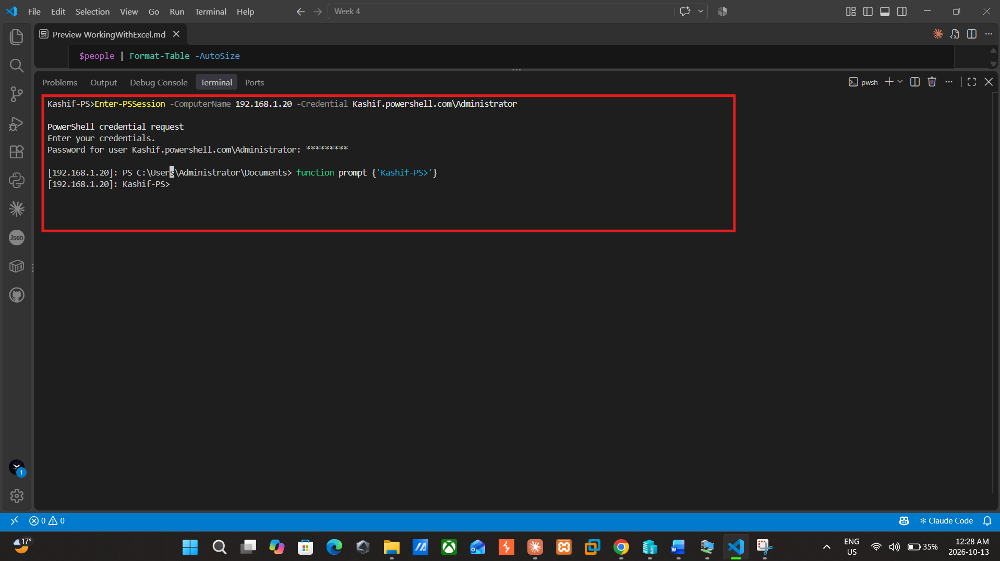

## Step 4: Import data from Excel

```powershell
Import-Excel "C:\Users\Administrator\Documents\Fruits.xlsx" -OutVariable fruit
$fruit | Get-Member
```

`Import-Excel` reads the data from Fruits.xlsx into PowerShell. The `-OutVariable fruit` parameter displays the data and also saves it in `$fruit` for later steps. `Get-Member` shows that each row is a **System.Management.Automation.PSCustomObject** with two **NoteProperty** entries, `Fruits` and `Quantity`, one for each column in the spreadsheet. The other entries (Equals, GetHashCode, GetType, ToString) are standard object methods. These column names are needed later for the chart.

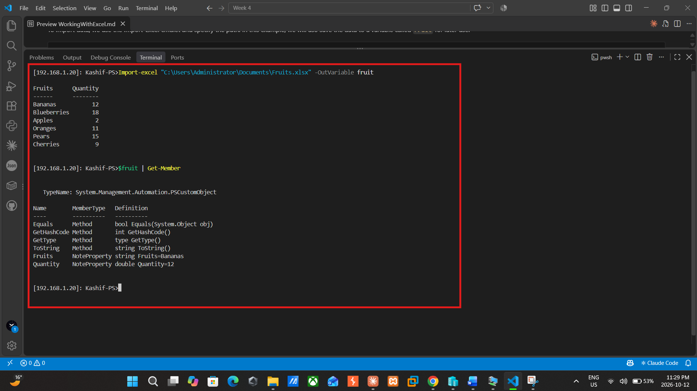

## Step 5: Export data to Excel

```powershell
Get-Process | Export-Excel "C:\Users\Administrator\Documents\ProcessInfo.xlsx" -WorksheetName Processes
dir "C:\Users\Administrator\Documents\ProcessInfo.xlsx"
```

I used `Get-Process` to get every process running on the server and piped it into `Export-Excel`, which saved it to a new file called **ProcessInfo.xlsx** on a worksheet named **Processes**. I added `-WorksheetName Processes` because the next step reads from a sheet with that name. The command printed nothing, which in PowerShell means it worked without errors. The `dir` command showed ProcessInfo.xlsx in the Documents folder at about 40 KB, so the file exists and has data in it.

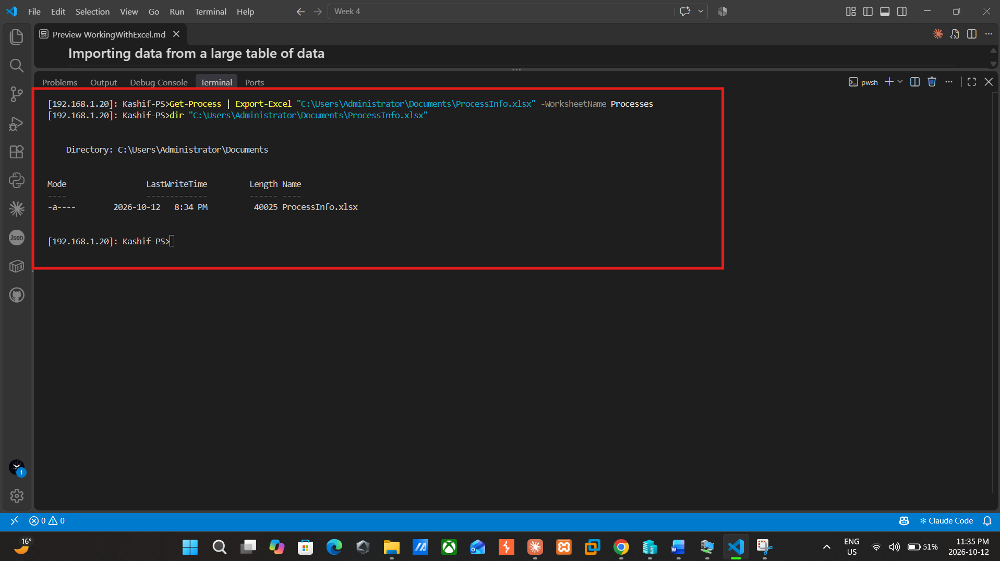

## Step 6: Import only selected columns and rows

```powershell
$cols = (Import-Excel "C:\Users\Administrator\Documents\ProcessInfo.xlsx" -WorksheetName Processes -EndRow 2)[0].PSObject.Properties.Name
$i = 1; foreach ($c in $cols) { "$i  $c"; $i++ }

Import-Excel "C:\Users\Administrator\Documents\ProcessInfo.xlsx" -WorksheetName Processes -ImportColumns @(1,48,10,5) -StartRow 1 -EndRow 7
```

ProcessInfo.xlsx has 67 columns, but I only needed **Name, ProcessName, CPU and memory**. The lab used column numbers `1,46,12,6`, but those didn't match my file, so I printed every column name with its number first. On my server, Name is column **1**, ProcessName is **48**, CPU is **10** and WS (working set, the memory) is **5**. `-ImportColumns @(1,48,10,5)` imports only those columns, in that order. `-StartRow 1` is the header row and `-EndRow 7` stops after 6 rows of data. The result is a small table with 4 columns and 6 processes.

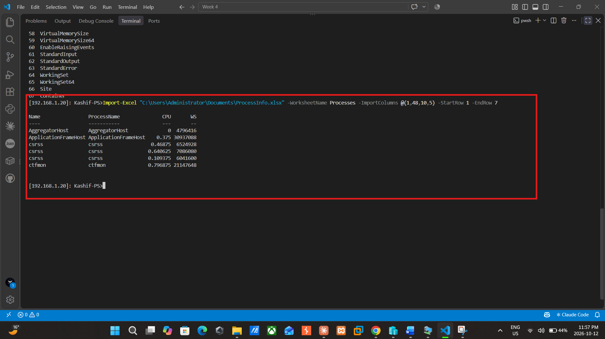

## Step 7: Add data to an existing spreadsheet

```powershell
$people = @(
    [PSCustomObject]@{ Name = "Jeremy"; City = "Loxahatchee" }
    [PSCustomObject]@{ Name = "Mike";   City = "Apex" }
    [PSCustomObject]@{ Name = "Kevin";  City = "Cary" }
    [PSCustomObject]@{ Name = "Phil";   City = "Holly Springs" }
)
$people | Format-Table -AutoSize

$people | Export-Excel "C:\Users\Administrator\Documents\ProcessInfo.xlsx" -Append -WorksheetName "People"
Import-Excel "C:\Users\Administrator\Documents\ProcessInfo.xlsx" -WorksheetName People
```

I created a small table of four people and their cities. Each `[PSCustomObject]` is one person with a Name and a City, and `@( )` puts them together in an array saved in `$people`. `Format-Table -AutoSize` let me check the data before exporting. I then exported it to ProcessInfo.xlsx with `-Append` and `-WorksheetName "People"`, which adds a new **People** tab without deleting the Processes tab. Importing the People sheet back showed the same four people, so the data was saved correctly.

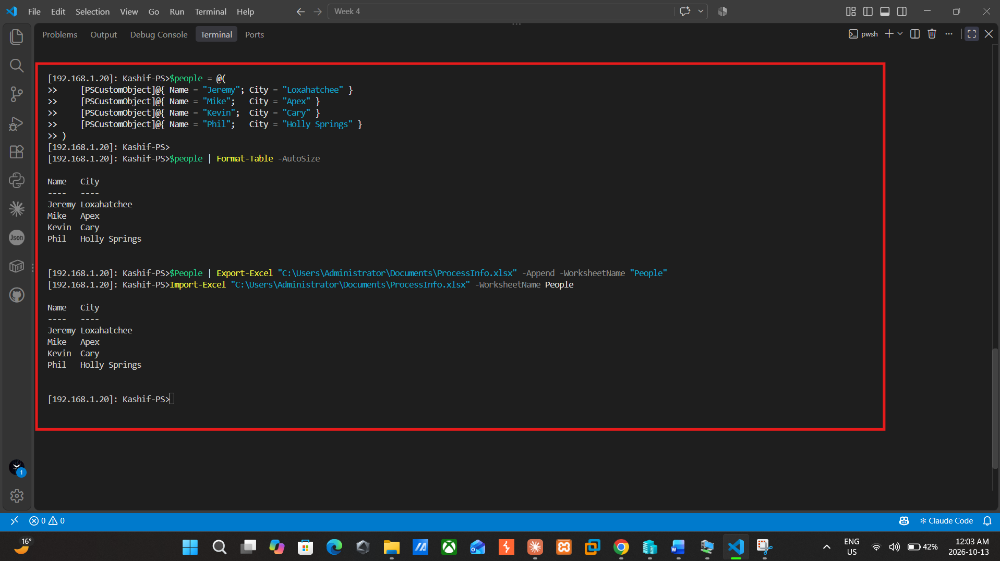

## Step 8: Export data with formatting (table style and title)

```powershell
$people | Export-Excel "C:\temp\ExcelDemo.xlsx" -Append -WorksheetName "PeopleFormatted" -TableStyle Medium16 -Title "Demo of Table Formatting" -TitleBold
dir C:\temp
```

In this step I exported the People data as a formatted table instead of plain rows. `-TableStyle Medium16` applies one of Excel's built-in table styles, `-Title` adds a heading above the table, and `-TitleBold` makes that heading bold. The data went into a new file, **ExcelDemo.xlsx**, on a tab named **PeopleFormatted**. The command printed nothing, and `dir C:\temp` showed that ExcelDemo.xlsx was created.

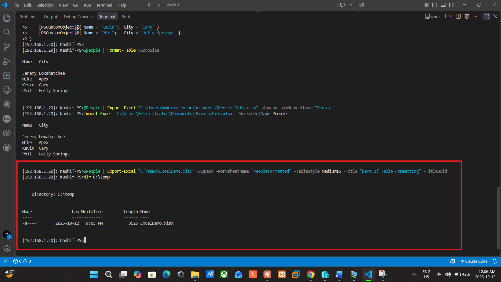

## Step 9: More formatting options (Fruits and People)

```powershell
$fruit = Import-Excel "C:\Users\Administrator\Documents\Fruits.xlsx"
$fruit | Export-Excel "C:\Users\Administrator\Documents\Fruits.xlsx" -WorksheetName FruitsFormatted -AutoSize -BoldTopRow -FreezeTopRow -AutoFilter -TableName FruitTable -TableStyle Medium2

$people = Import-Excel "C:\Users\Administrator\Documents\ProcessInfo.xlsx" -WorksheetName People
$people | Export-Excel "C:\Users\Administrator\Documents\ProcessInfo.xlsx" -WorksheetName People -ClearSheet -AutoSize -BoldTopRow -TableName PeopleTable -TableStyle Medium9
```

Here I tried more formatting options. For the fruit data, I added a new tab called **FruitsFormatted** to Fruits.xlsx. `-AutoSize` fits the column widths to the data, `-BoldTopRow` makes the header bold, `-FreezeTopRow` keeps the header visible when scrolling, `-AutoFilter` adds filter buttons to the headers, and `-TableName`/`-TableStyle` save the data as a styled Excel table. For ProcessInfo.xlsx, `-ClearSheet` removed the old People data, and the tab was rewritten as a formatted table called **PeopleTable**. Neither command printed anything, so both worked.

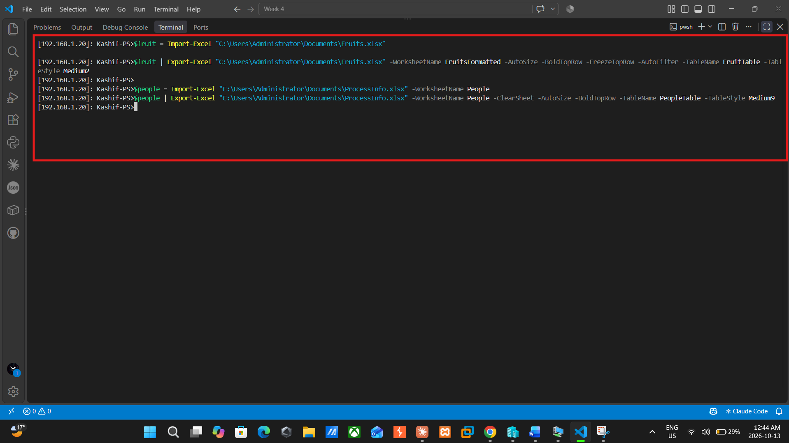

## Step 10: Create a chart

```powershell
$people | Export-Excel C:\temp\KashifLab4Report.xlsx -WorksheetName "StaffLocations" -TableStyle Medium4 -Title "Staff and Their Home Cities" -TitleBold -AutoSize

$fruit = Import-Excel "C:\Users\Administrator\Documents\Fruits.xlsx"
$FruitChart = New-ExcelChartDefinition -XRange Fruits -YRange Quantity -ChartType ColumnClustered -Title "Fruit Quantity Overview" -SeriesHeader "Total Units" -XAxisTitleText "Fruit Name" -YAxisTitleText "Quantity Available" -Row 1 -Column 3
$fruit | Export-Excel C:\temp\KashifLab4Report.xlsx -Append -WorksheetName "FruitOverviewChart" -AutoNameRange -AutoSize -ExcelChartDefinition $FruitChart
```

First, I made a formatted **StaffLocations** tab in a new file, **KashifLab4Report.xlsx**, with a green Medium4 table and the bold title "Staff and Their Home Cities". Then I used `New-ExcelChartDefinition` to set up a column chart: fruit names on the X axis, quantities on the Y axis, the title **"Fruit Quantity Overview"** and the legend name **"Total Units"**. `Export-Excel` with `-Append` and `-ExcelChartDefinition` added a new tab called **FruitOverviewChart** with the fruit table and the chart. `-AutoNameRange` names the Fruits and Quantity columns so the chart can find them.

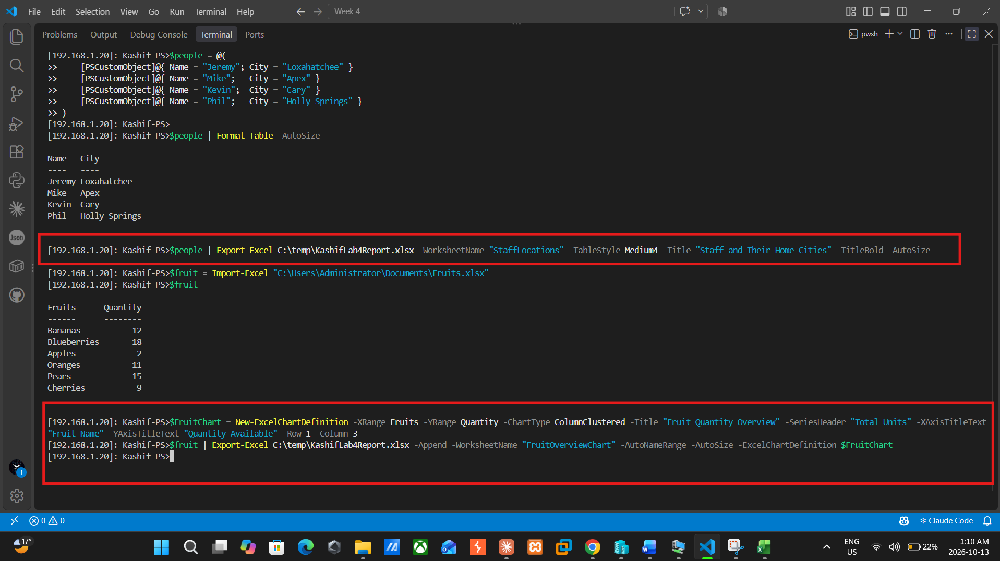

The server doesn't have Excel, so I copied the file back to my laptop to open it:

```powershell
Exit-PSSession
Copy-Item -FromSession $session -Path C:\temp\KashifLab4Report.xlsx -Destination "C:\Users\Owner\OneDrive - Sheridan College\Desktop\Sheridan College\SYST Powershell\Week 4"
```

The **StaffLocations** tab shows the bold title and the four people in a green table with filter buttons.

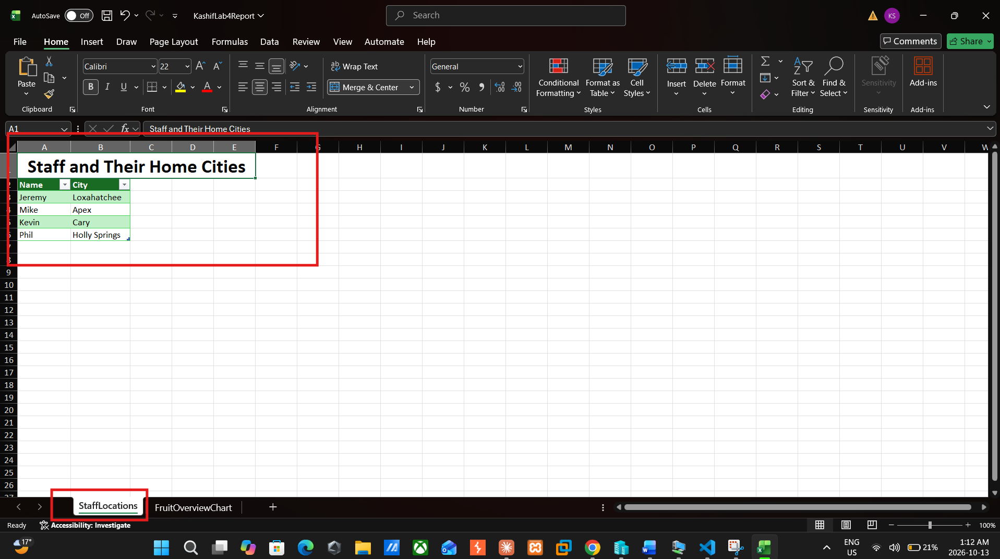

The **FruitOverviewChart** tab shows the fruit table and the column chart beside it. The chart matches the table: **Blueberries** is the tallest bar at 18 and **Apples** is the shortest at 2.

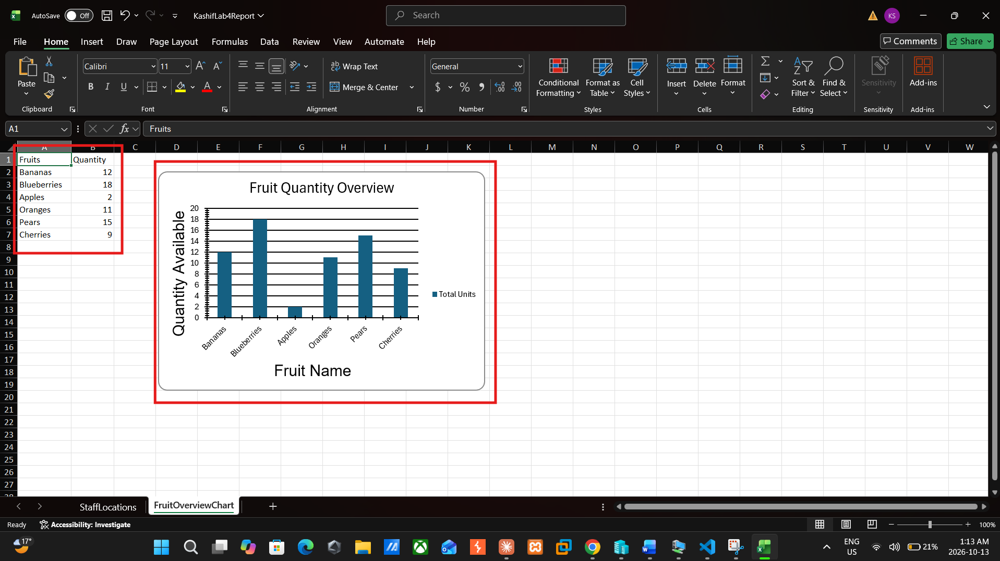

---

## Reflection

This lab uses the ImportExcel module to work with Excel files from PowerShell without the Microsoft Excel app. What was most helpful was learning that `Import-Excel` converts each row of a spreadsheet into a PSCustomObject, which means that you can use the data in the same way as any other PowerShell output. `Export-Excel` does the opposite: it can take the output of a command, such as `Get-Process`, and save it directly to a spreadsheet.
 
The most difficult part for me was at the beginning. I ran `Install-Module` on the server, and it failed with a NuGet error because the server doesn't have internet access. To get around this, I downloaded the module on my laptop using `Save-Module` and copied it into the server's module folder using `Copy-Item -ToSession`. That taught me that a module needs to be installed on the machine where the commands are executed, and not only on my own computer.
 
I also noticed a few problems with the lab instructions, such as the need to add a space before the `@` in `-ImportColumns`, and that columns 1, 46, 12 and 6 did not match my file. I printed my own column list and discovered that Name, ProcessName, CPU and WS were columns 1, 48, 10 and 5 on my server. Later, my `$people` variable was empty and the table export would not work, so I re-entered the data myself. I also learned that the chart is not on the People tab, but on a separate worksheet.
 
Overall, this lab taught me to always be careful with the output and error messages, and not to take the instructions for granted, because they don't always apply to my environment. These skills will come in very handy when building automated reports from servers in the future.
